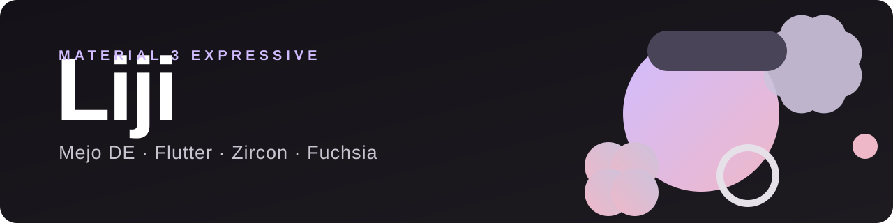

<div align="center">



# Liji

**Операционная система на базе Zircon и Fuchsia с десктоп-окружением Mejo на Flutter**

[](LICENSE)
[](docs/roadmap.md)
[](docs/architecture.md)
[](.github/workflows/ci.yml)

</div>

---

## Что это

**Liji** — экспериментальная операционная система для настольных компьютеров, которая строится не «с нуля ради нуля», а на прочном фундаменте: микроядре **Zircon** и системных компонентах **Fuchsia**. Из Fuchsia мы берём только то, что делает её настоящей современной ОС — ядро, компонентный фреймворк, драйверы, графику, ввод, сеть и аудио — и осознанно не тянем с собой весь остальной багаж. Поверх этого работает **Mejo** — десктоп-окружение, написанное на **Flutter** в визуальном языке **Material 3 Expressive**.

Почему такая связка? Zircon — это микроядро без сорокалетнего legacy: вместо классических UID-правд у него capability-based безопасность, вместо «всё в ядре» — изоляция всего и вся в песочницах, а драйверы живут в пользовательском пространстве. Flutter на Fuchsia — не «портированный гость», а родной житель: движок Flutter исторически собирался под Zircon и общается с системой напрямую через FIDL. А Material 3 Expressive — самый свежий визуальный язык Material, с крупными выразительными формами, живой типографикой и плавными фоновыми переходами — идеальный язык для DE, которое должно выглядеть по-новому, а не как ещё одна копия 2010-х.

Цель проекта — получить **лёгкую, быструю и целостную ОС**, где ядро, системные сервисы и интерфейс спроектированы согласованно, а не склеены из разнородных слоёв. Liji остаётся операционной системой в полном смысле: с загрузкой, драйверами, файловой системой, сетью и пакетами. Это не «огрызок» и не живая сборка из обрезков — это Fuchsia, сфокусированная на десктопе.

## Ключевые решения

| Компонент | Выбор | Почему |
|---|---|---|
| Ядро | **Zircon** | Микроядро, capability-based безопасность, драйверы в user space |
| Системная база | **Fuchsia** (урезанная) | Компонентный фреймворк, FIDL, файловая система, сеть, обновления |
| DE | **Mejo** на Flutter | Единый runtime UI, горячая разработка, декларативный UI |
| Дизайн | **Material 3 Expressive** | Крупные формы, выразительная типографика, живая анимация |
| Графика | Scenic / Vulkan | Композиция поверх Vulkan, готово к GPU-ускорению |
| Целевые платформы | x64 (QEMU → железо), затем ARM64 | Начинаем с эмулятора, заканчиваем реальными машинами |

## Архитектура

```
┌─────────────────────────────────────────────────┐
│                    Mejo DE                      │
│   shell · launcher · панель · окна · виджеты    │
├─────────────────────────────────────────────────┤
│              Flutter Engine / Dart              │
├───────────────────────────┬─────────────────────┤
│   Fuchsia core (урез.)    │      Приложения     │
│  comp фреймворк · драйверы│  как компоненты в   │
│  Scenic · ввод · аудио    │      песочницах     │
│  netstack · fs · FIDL     │                     │
├───────────────────────────┴─────────────────────┤
│                   Zircon                        │
│      процессы · capability · vmo · порты        │
└─────────────────────────────────────────────────┘
```

Подробный разбор слоёв, принципы «что режем, что оставляем» и стратегия сборки — в [docs/architecture.md](docs/architecture.md).

## Почему Fuchsia, а не Linux

Linux — великолепное ядро, но он монолитен по духу: миллионы строк драйверов, десятилетия ABI-обязательств и модель безопасности, где всё держится на UID. Для десктопа нового поколения это и сила, и якорь. Zircon идёт другим путём: каждый процесс получает только те права (capabilities), которые ему явно выдали; каждый драйвер и каждый сервис изолирован в собственной песочнице; падение одного компонента не валит систему. Для пользователя это означает ОС, которая фактически не может «загрязниться» со временем, а для разработчика — предсказуемую и чистую системную модель.

Второй аргумент — Flutter. В мире Linux DES-фреймворки (GTK, Qt) появились до эпохи декларативного UI, и это чувствуется: рендеринг через X11/Wayland-клей, разнобой toolkit'ов, тяжёлые темы. В Liji весь интерфейс — от лаунчера до системных настроек — живёт в одном Dart/Flutter-мире с одним рендерером (Impeller/Vulkan), одним языком и одним дизайн-системой. Mejo получается не «ещё одним окружением среди десятка», а продолжением самой платформы.

Третий аргумент — обновления. Fuchsia изначально построена вокруг атомарных A/B-обновлений: система обновляется целиком, как единый образ, с откатом при неудаче. Десктопная ОС, которая обновляется без страха «сломать систему», — это то, чего пользователи ждут десятилетиями.

## «Вырезаем лишнее», но ОС остаётся ОС

Мы не строим огрызок. Из выкачки и сборки исключается то, что не нужно десктопной ОС Liji: сэмплы и демо-приложения, устаревшие экспериментальные перталсы, тяжёлые тестовые деревья, лишние продукты и платы. При этом ядро системы остаётся полноценным:

**Оставляем:** Zircon, компонентный фреймворк, FIDL, драйверный фреймворк DFv2, графический композитор Scenic, подсистему ввода, аудио, сетевой стек, файловые системы, flutter runner, обновляемость.

**Вырезаем:** сэмплы и примеры, исходные доки (есть онлайн), тестовые деревья вне базовой конфигурации, экспериментальные оболочки (их место занимает Mejo), прочие невостребованные продукты.

Технически урезание работает на двух уровнях: на уровне манифеста jiri (берём `stem` вместо полного `flower`) и на уровне дерева исходников (скрипт `prune_fuchsia.sh`). Плюс главный инструмент фокусировки — продуктовая конфигурация сборки `fx set`, которая и так компилирует только то, что реально входит в образ.

## Структура репозитория

```
Liji/
├── assets/            баннер и графика
├── docs/              архитектура и дорожная карта
├── scripts/           выкачка и обрезка исходников Fuchsia
│   ├── fetch_fuchsia.sh
│   └── prune_fuchsia.sh
└── .github/           CI
```

Репозиторий `Liji` хранит **наш код и наши скрипты** — исходники самой Fuchsia не коммитятся сюда, а выкачиваются скриптом локально (это сотни git-репозиториев под управлением jiri, им не место в нашем tree).

## Быстрый старт

Требования: Linux x64, `curl`, `file`, `git` ≥ 2.31, `unzip`, ~3 ГБ на выкачку исходников (и 80–90 ГБ под будущую сборку), желательно KVM для эмулятора.

```bash
# 1. Выкачать исходники Fuchsia (по умолчанию лёгкий манифест stem)
./scripts/fetch_fuchsia.sh

# Полная выкачка (манифест flower):
./scripts/fetch_fuchsia.sh -m flower -d ~/fuchsia

# 2. Обрезать лишнее (сначала посмотреть, потом применить)
./scripts/prune_fuchsia.sh ~/liji-fuchsia
./scripts/prune_fuchsia.sh ~/liji-fuchsia --apply
```

Дальше — настройка окружения и первая сборка по [дорожной карте](docs/roadmap.md).

## Дорожная карта

- **Фаза 0** — репозиторий, скрипты выкачки и обрезки, документация *(сейчас)*
- **Фаза 1** — урезанная выкачка, первая сборка `core.x64`, запуск в QEMU/FEMU
- **Фаза 2** — минимальный образ Liji: загрузка, вход, системные сервисы
- **Фаза 3** — Flutter runtime в образе, первый нативный UI-компонент
- **Фаза 4** — Mejo MVP: shell, лаунчер, окна
- **Фаза 5** — дизайн-система M3E: темы, формы, компоненты, анимации
- **Фаза 6** — образы для реального железа x64, затем ARM64

Детально — в [docs/roadmap.md](docs/roadmap.md).

## English summary

**Liji** is an experimental desktop operating system built on the **Zircon** microkernel and the core of **Fuchsia**, paired with **Mejo** — a desktop environment written in **Flutter** using the **Material 3 Expressive** design language. The idea: Zircon is a capability-based microkernel with sandboxed user-space drivers and no legacy burden; Flutter is a first-class runtime on Fuchsia; M3E brings bold shapes, expressive typography and fluid motion. We trim everything a desktop OS does not need (samples, legacy petals, heavy test trees) while keeping the system a *real* OS: kernel, component framework, drivers, graphics, input, audio, networking and OTA-style updates. See [docs/architecture.md](docs/architecture.md) and [docs/roadmap.md](docs/roadmap.md). Fetch the sources with `scripts/fetch_fuchsia.sh` and trim them with `scripts/prune_fuchsia.sh`.

## Юридическая заметка

Проект Liji не аффилирован с Google. Fuchsia, Zircon, Flutter, Android и Material — торговые марки Google LLC; Liji использует открытый исходный код Fuchsia в соответствии с его лицензиями (BSD, MIT, Apache-2.0). Собственный код Liji распространяется по лицензии [Apache-2.0](LICENSE). При распространении производных образов сохраняйте лицензионные уведомления upstream-компонентов.
