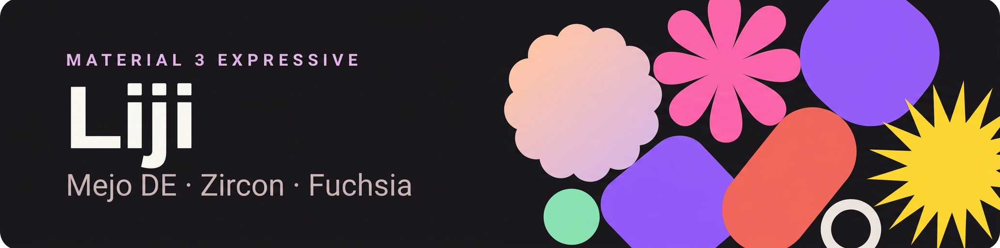

<div align="center">



# Liji

**Операционная система на базе Zircon и Fuchsia с десктоп-окружением Mejo**

[](LICENSE)
[](https://github.com/mel0k1/Liji/actions/workflows/ci.yml)
[](https://github.com/mel0k1/Liji/actions/workflows/source-snapshot.yml)
[](https://github.com/mel0k1/Liji/actions/workflows/build.yml)
[](docs/architecture.md)

</div>

---

## Что это

Liji — экспериментальная десктопная ОС. Ядро — Zircon, системная база — урезанное ядро Fuchsia, оболочка — Mejo. Из платформы берётся только то, что делает её настоящей ОС: компонентный фреймворк, драйверы, графика, ввод, звук, сеть, обновления. Никаких сэмплов, демо и мёртвых перталсов.

Урезание ведётся штатными механизмами платформы, а не удалением каталогов: лёгкий манифест jiri (`stem` вместо `flower`) на этапе выкачки и продуктовая конфигурация `fx set` с собственным файлом продукта на этапе сборки. Liji собирается из чистого чекаута стандартными инструментами Fuchsia, и любой другой сборщик может использовать то же дерево исходников для своего продукта без сюрпризов.

## Ключевые решения

| Компонент | Выбор | Почему |
|---|---|---|
| Ядро | Zircon | Микроядро, capability-безопасность, драйверы в user space |
| Системная база | Fuchsia core | CFv2, FIDL, Scenic, netstack, файловые системы |
| Оболочка | Mejo | Единый рендер и единая дизайн-система на весь UI |
| Платформы | x64 → ARM64 | QEMU, затем реальное железо |

## Почему Zircon

- **Изоляция по умолчанию.** Процесс получает только явно выданные права (capability); приложения и сервисы не видят ничего лишнего.
- **Драйверы в user space.** Упавший драйвер перезапускается и не роняет систему.
- **A/B-обновления.** Система обновляется целиком, одним образом, с откатом при неудаче.

Подробности слоёв и сборки — в [docs/architecture.md](docs/architecture.md).

## Структура

```
Liji/
├── assets/            графика
├── docs/              архитектура, roadmap, гайд сборки
├── products/          продуктовая конфигурация Liji (fx set)
├── mejo/              каркас оболочки: панель, часы, лаунчер
├── scripts/           выкачка исходников Fuchsia, boot-тест эмулятора
└── .github/           CI: снапшот исходников, сборка с boot-тестом, проверки
```

## Выкачка и сборка — в CI, без 100 ГБ на диске

Тяжёлое живёт в GitHub Actions, локально нужен только этот репозиторий:

1. **source-snapshot** — выкачка через jiri по официальному манифесту `stem`, упаковка в tar.zst и публикация в Releases (частями по 1.9 ГБ).
2. **build** — восстановление снапшота, `fx set` / `fx build` штатными инструментами и головной boot-тест в FEMU; serial-лог — в артефактах.

Запуск: Actions → соответствующий workflow → Run workflow; сборка стартует и автоматически после свежего снапшота.

Локальная сборка на машине со 100+ ГБ и детали — в [docs/build.md](docs/build.md).

## Дорожная карта

- **Фаза 1** — выкачка, первая сборка и запуск в FEMU *(выкачка и сборка идут в CI)*
- **Фаза 2** — минимальный образ Liji: загрузка, вход, системные сервисы
- **Фаза 3** — Flutter runtime в образе, первый нативный UI-компонент
- **Фаза 4** — Mejo MVP: shell, лаунчер, окна

Детали — в [docs/roadmap.md](docs/roadmap.md).

## English summary

Liji is an experimental desktop OS: the Zircon microkernel, a trimmed Fuchsia core as the system base, and the Mejo desktop shell. Trimming is done with the platform's own mechanisms — the `stem` jiri manifest for checkout and `fx set` product configurations for builds — so Liji builds from a clean checkout with standard Fuchsia tooling. Source sync and builds run in GitHub CI (`source-snapshot` and `build` workflows), so no huge disk is needed locally; local steps are described in [docs/build.md](docs/build.md).

## Юридическая заметка

Проект не аффилирован с Google. Fuchsia, Zircon и Material — торговые марки Google LLC; используются открытые исходники Fuchsia в соответствии с его лицензиями (BSD, MIT, Apache-2.0). Код Liji — [Apache-2.0](LICENSE).
